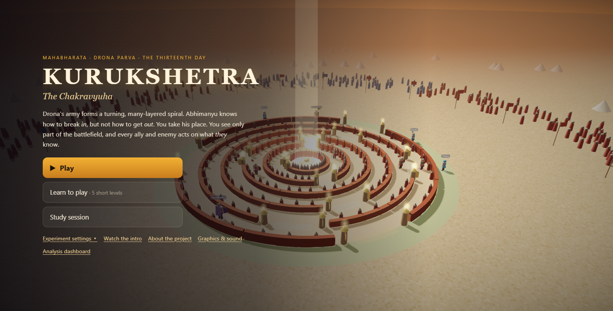
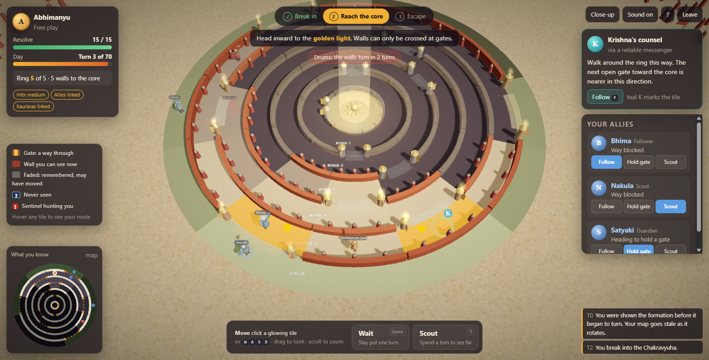
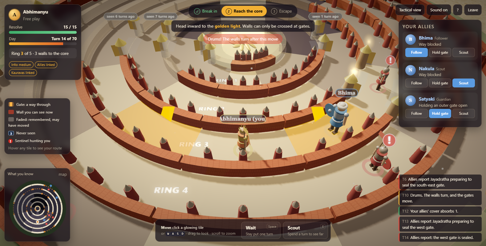
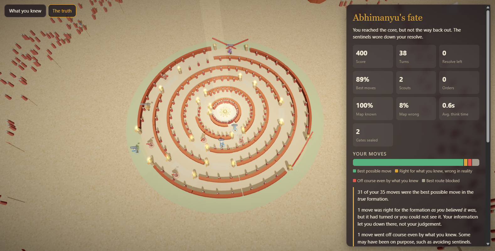
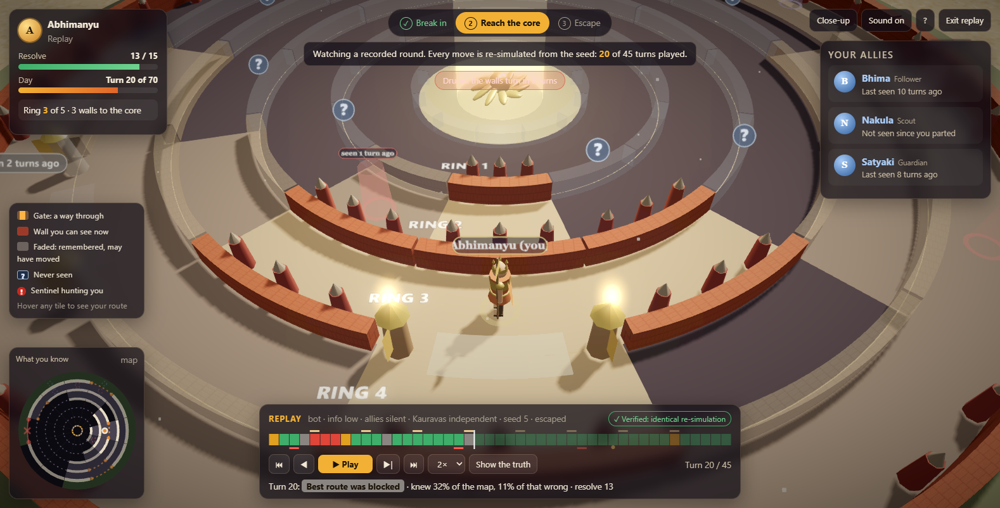
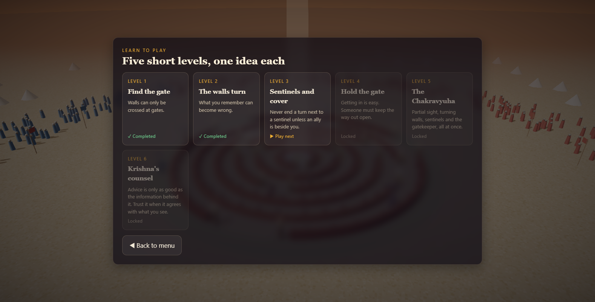
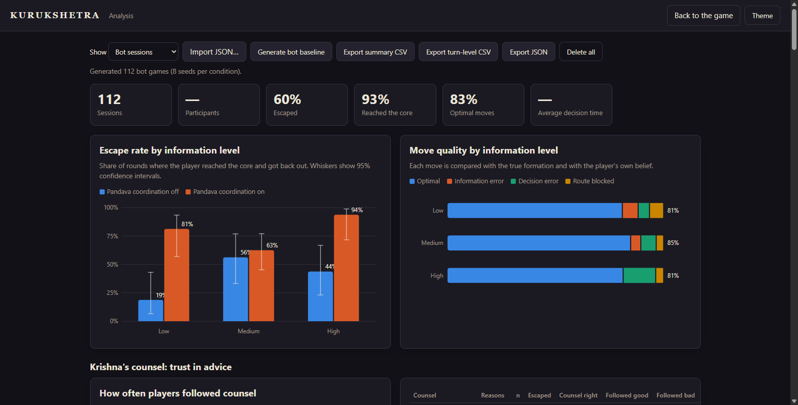
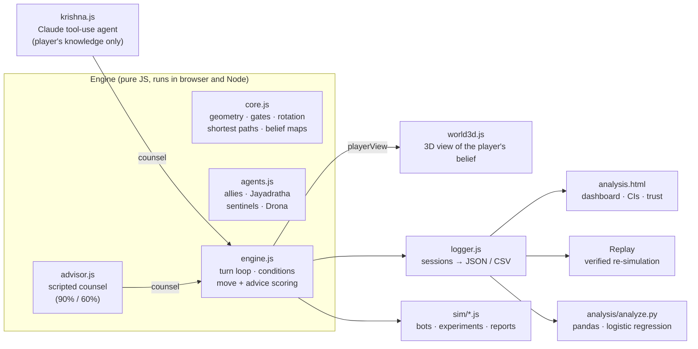

<div align="center">

# KURUKSHETRA

**A 3D multi-agent strategy game for studying how people decide with incomplete information, and when they should trust an AI advisor.**

Inspired by the *Chakravyuha* from the Mahabharata · built as a research instrument, not just a game

**[▶ Play it in your browser](https://shravyasaravanane.github.io/kurukshetra/)** · [Research dashboard](https://shravyasaravanane.github.io/kurukshetra/analysis.html) · [Complete guide](docs/GUIDE.md)

     



</div>

## The idea in one minute

On the thirteenth day of the Kurukshetra war, Drona arranges his army into the **Chakravyuha**, a turning, many-ringed formation. Abhimanyu knows how to break *in*, but not how to get *out*. His allies are meant to follow him through the breach, but Jayadratha seals it. Abhimanyu reaches the heart of the formation and never comes back. Arjuna, by contrast, has the best advisor in the world: Krishna, driving his chariot.

That story describes two problems people face every day.

1. **Deciding with partial, changing information, alongside others who know different things.** One person holds part of the picture, the situation keeps moving, and success depends on coordination.
2. **Deciding how much to trust advice.** That advice may come from a colleague, a dashboard or an AI system, and it is only as good as the information behind it.

KURUKSHETRA puts a human player in Abhimanyu's place. They are surrounded by autonomous agents and can be offered **Krishna's counsel**. The counsel comes from messengers of known reliability, from **Krishna's insight** (a free advisor that reasons only from what the player knows), or from **a real LLM agent (Claude)**. The game logs every decision against what the player *believed*, what was *true*, and whether they followed the advice. That record separates three kinds of mistake that are usually lumped together:

> **Information error:** the move was right for what you knew, but what you knew was wrong.
> **Decision error:** the move was wrong even by your own information.
> **Miscalibrated trust:** following counsel that was wrong, or ignoring counsel that was right.

## Screenshots

| Krishna's counsel: the teal K marks the advised tile | Fog of war: dark rings are unseen, faded walls are remembered |
|---|---|
|  |  |
| **Debrief: switch the whole battlefield to "the truth"** | **Replay: re-simulate any recorded round, turn by turn** |
|  |  |
| **Learn to play: six short levels, one idea each** | **Analysis dashboard: conditions, trust, 95% CIs** |
|  |  |

## Headline results (simulated agents)

**Trust in advice** ([results/COUNSEL.md](results/COUNSEL.md)): 200 seeded games per cell, medium information.


| Change in escape rate vs. no counsel (49.5%) | Δ | p |
|---|---|---|
| Reliable messenger (90%), **calibrated** trust | **+15.5 pts** | 0.002 |
| Reliable messenger, always trust | +7.5 pts | 0.133 (n.s.) |
| Careless messenger (60%), always trust | **−48.0 pts** (to 1.5%) | < 0.001 |
| Careless messenger, **calibrated** trust | −5.0 pts | 0.316 (n.s.) |

- **Even good advice needs judgement.** Only calibrated trust turns a 90%-reliable advisor into a significant gain.
- **An advisor that only knows what you know can't fix your blind spots.** Krishna's insight is right 95% of the time, and every wrong piece is wrong because the player's own information was. For a player who already plans perfectly on their own map, it adds nothing significant (p = 0.617).
- **Blind trust in a bad source is catastrophic, and calibration almost fully protects against it.** In a logistic regression, calibrated trust multiplies the odds of escaping by about 53 compared with blind trust in the careless messenger ([results/ANALYSIS_PY.md](results/ANALYSIS_PY.md)).

**Information and coordination** ([results/REPORT.md](results/REPORT.md)): 7,200 games, 3 agents × 12 conditions × 200 seeds.

| Effect on the escape rate (belief-planning agent) | Δ | p |
|---|---|---|
| Low → high information | **+28.6 pts** (49.3% → 77.9%) | < 0.001 |
| Low → medium information (a one-time briefing that goes stale) | +4.3 pts | 0.089 (n.s.) |
| Ally coordination off → on | **+24.6 pts** | < 0.001 |
| Enemy coordination off → on | **−17.1 pts** | < 0.001 |

These are scripted agents. They are the reference curves the human study is compared against.

## Krishna, the AI advisor agent

> **No API key needed to use the project.** Every experiment runs on the free, offline advisors. **Krishna's insight** asks the same research question as the LLM, "can advice limited to your information fix your blind spots?", deterministically and at no cost. The Claude agent is fully built and tested against a mock client. A live run is optional.

Krishna is an **LLM agent** built on Claude through the official Anthropic SDK, using a manual tool-use loop ([js/krishna.js](js/krishna.js)).

- **Held to the player's information.** Its tools are `get_situation`, `get_known_map`, `get_legal_moves` and `plan_route`. They read only the player's belief, sight and legal moves, never the truth, so its advice can go wrong for the same reasons a human's can. A unit test enforces this.
- **Structured output.** It finishes by calling a strict `give_advice` tool with a move, an explanation and a confidence level. An illegal move is returned to it as a tool error, so it can correct itself.
- **Production-minded.**
  - Default model `claude-opus-5-5` at low effort, for speed.
  - The system prompt is cached.
  - Responses are appended unchanged, so thinking blocks are preserved.
  - Parallel tool calls are answered in a single message.
  - Refusals are handled explicitly, with server-side fallbacks (`fallbacks: "default"`) switched on.
- **Evaluated, not just demoed.** `sim/krishna-eval.js` runs the agent over seeded games and scores every piece of counsel against the truth. It reports good, shortest-path, information-error and decision-error rates, plus latency, token use and estimated cost. A `--mock` mode runs the whole pipeline in CI without an API key.
- **In the game,** paste an Anthropic API key into *Experiment settings → Counsel → AI agent*. The SDK is loaded from the CDN only for that condition, so the rest of the game stays offline. This is a local research build: the key stays in your browser.

## What makes it interesting

**For players**
- A full 3D battlefield (Three.js) with animated characters, turning ranks of soldiers, torch-lit gates, high-dynamic-range (HDR) bloom and synthesised sound.
- **Six short learn-to-play levels**, each teaching one idea, with a coach, stars and unlocks. The heads-up display (HUD) reveals itself gradually.
- **Readable at a glance:**
  - A tactical camera and ring labels on the ground.
  - "Ring 3 of 5 · 3 walls to the core".
  - Route preview on hover.
  - A **?** at the edge of what you know, and "seen 4 turns ago" tags on remembered gates.
  - A **!** over hunting sentinels, and red and blue lines showing who drained you and who covered you.
  - A drum countdown before the walls turn.

**For researchers**
- **Five manipulations:**
  - Information level.
  - Ally coordination.
  - Enemy coordination.
  - Advisor: none, reliable, careless, Krishna's insight (free) or LLM.
  - Whether advice comes with reasons.

  Every comparison runs on identical seeded formations.
- **Decision-quality metric:** every move is scored against true and believed shortest-path fields.
- **Reliance metrics:** followed good counsel, followed bad counsel, and appropriate reliance.
- **Two study protocols:**
  - An information study and a counsel study, each counterbalanced from the participant ID.
  - Practice levels first.
  - A post-round questionnaire.
  - Decision times that exclude pauses.
- **Deterministic replay** that verifies itself and shows what counsel was on screen at each turn.

**For engineers**
- **The game has no build step and no runtime dependencies.** You can double-click `index.html` or deploy it as a static site.
- **One engine, two hosts.** The same files run in the browser and in Node, for the tests, simulators and agent evaluation.
- **34 unit tests and 8 end-to-end browser tests.** The browser tests run through a zero-dependency Chrome DevTools Protocol driver. The agent loop is tested against a mock Claude client.
- **Python analysis layer** using pandas, NumPy and matplotlib, with a logistic regression fitted by iteratively reweighted least squares.
- **CI** runs the Node, browser and Python jobs, and a **GitHub Pages** workflow deploys the game.

## Quick start

```sh
# Play: open index.html in a browser, or serve it locally
npm start                         # http://localhost:8080

# Verify
npm test                          # 34 engine, counsel, agent, level and statistics tests
npm run test:e2e                  # 8 browser tests in headless Chrome or Edge

# Research
npm run sim                       # information x coordination: 7,200 games -> results/REPORT.md
npm run counsel                   # trust in advice: 2,000 games -> results/COUNSEL.md + counsel-games.csv
npm run krishna:mock              # LLM-agent evaluation pipeline, no API calls
npm install && npm run krishna:eval -- --yes --seeds 3   # live evaluation (needs ANTHROPIC_API_KEY; costs money)

# Python analysis
python -m venv .venv && .venv/Scripts/pip install -r analysis/requirements.txt   # (bin/ on macOS and Linux)
.venv/Scripts/python analysis/analyze.py                  # results/ANALYSIS_PY.md + figures
.venv/Scripts/python analysis/analyze.py --sessions exported-summary.csv   # add human sessions
```

## How it works



## Documentation

- **[The complete guide](docs/GUIDE.md):** every rule, agent, metric and file. It also covers how Krishna works, how to run both studies, how all of this applies to real-world decisions, and viva questions with answers.
- **[Project plan](docs/PLAN.md):** the research framing, experimental design and milestones.
- **Reports:** [information and coordination](results/REPORT.md) · [trust in advice](results/COUNSEL.md) · [Python analysis](results/ANALYSIS_PY.md).

## Project structure

```
index.html / analysis.html   the 3D game and the research dashboard
js/core.js                   seeded RNG, ring/gate geometry, rotation, Dijkstra, belief maps
js/agents.js                 ally, gatekeeper, sentinel and commander policies
js/engine.js                 deterministic turn loop, conditions, move and advice scoring
js/advisor.js                messengers of controlled reliability, Krishna's insight (knowledge-only planner), scoring against the expert
js/krishna.js                the Claude tool-use advisor agent
js/bots.js                   baseline players, including trust policies (ignore / always / calibrated)
js/levels.js                 the six learn-to-play levels (tested for winnability)
js/world3d.js, characters.js 3D battlefield, effects, camera, HDR pipeline; animated characters
js/ui.js, analysis.js        game screens, HUD, study modes, replay; dashboard
js/logger.js, stats.js       session schema and exports; Wilson CIs, z-tests, reliance stats
sim/                         experiment runners, report generators, LLM-agent evaluation harness
analysis/                    Python analysis (pandas, numpy, matplotlib)
tests/                       unit tests and browser end-to-end tests
tools/                       CDP browser driver, screenshot generator, static server
results/  docs/  vendor/     reports and figures; guide, plan, screenshots; three.js r128 (MIT)
```

## Project context

**Team:** Ansika Pandey, Shravya S., Shamitha Velugu and Dharani B

This is a Mini Research & Innovation Project for the B.Tech II Year at Amrita Vishwa Vidyapeetham, Chennai, under the theme *Strategic Lessons from the Mahabharata*. The Mahabharata supplies the strategic insight, the game supplies the experimental environment, and the gameplay data supplies the evidence.

## License

MIT © 2026 Ansika Pandey, Shravya S., Shamitha Velugu and Dharani B. See [LICENSE](LICENSE). Three.js and its add-ons in `vendor/` are MIT licensed by the three.js authors.
