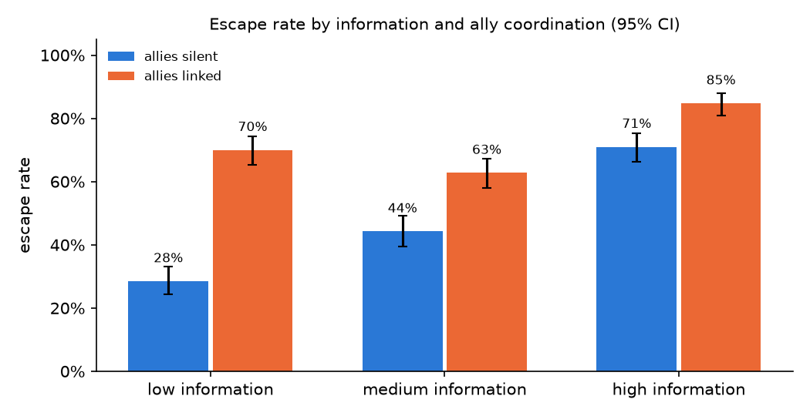
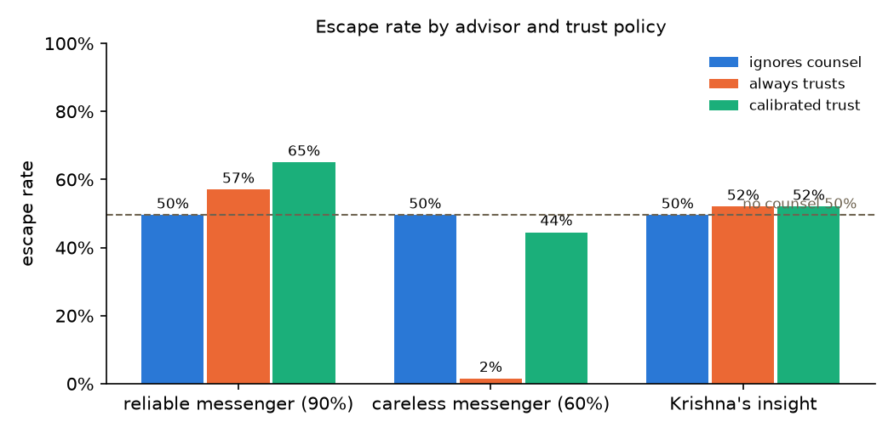

# KURUKSHETRA — Python analysis

Generated by `python analysis/analyze.py` (pandas, numpy, matplotlib).

## Simulator: escape rate by condition

7,200 games, 200 seeds per condition.

Belief-planning agent, Wilson 95% intervals:

| information | allies linked | enemies linked | n | escaped |
|---|---|---|---|---|
| low | off | off | 200 | 35.5% (29.2%–42.3%) |
| low | off | on | 200 | 21.5% (16.4%–27.7%) |
| low | on | off | 200 | 79.5% (73.4%–84.5%) |
| low | on | on | 200 | 60.5% (53.6%–67.0%) |
| medium | off | off | 200 | 55.0% (48.1%–61.7%) |
| medium | off | on | 200 | 33.5% (27.3%–40.3%) |
| medium | on | off | 200 | 76.0% (69.6%–81.4%) |
| medium | on | on | 200 | 49.5% (42.6%–56.4%) |
| high | off | off | 200 | 75.5% (69.1%–80.9%) |
| high | off | on | 200 | 66.5% (59.7%–72.7%) |
| high | on | off | 200 | 91.0% (86.2%–94.2%) |
| high | on | on | 200 | 78.5% (72.3%–83.6%) |

### Logistic regression (belief-planning agent)

`escaped ~ information + allies linked + enemies linked`. An odds ratio above 1 raises the odds of escaping.

| term | odds ratio | 95% CI | p |
|---|---|---|---|
| intercept | 0.81 | 0.67–0.99 | 0.035 |
| info: medium (vs low) | 1.21 | 0.98–1.49 | 0.071 |
| info: high (vs low) | 4.19 | 3.33–5.28 | < 0.001 |
| allies linked | 3.26 | 2.71–3.91 | < 0.001 |
| enemies linked | 0.43 | 0.36–0.52 | < 0.001 |

Holding the other factors fixed, live information multiplies the odds of escaping by **4.2**, linking the allies by **3.3**, and enemy coordination by **0.43**.

## Counsel: trust in advice

| advisor | trust policy | n | escaped | followed good | followed bad |
|---|---|---|---|---|---|
| none | belief | 200 | 49.5% (42.6%–56.4%) | — | — |
| reliable | belief | 200 | 49.5% (42.6%–56.4%) | 81.9% | 5.3% |
| reliable | calibrated | 200 | 65.0% (58.2%–71.3%) | 92.5% | 22.9% |
| reliable | truster | 200 | 57.0% (50.1%–63.7%) | 100.0% | 100.0% |
| unreliable | belief | 200 | 49.5% (42.6%–56.4%) | 80.4% | 4.4% |
| unreliable | calibrated | 200 | 44.5% (37.8%–51.4%) | 91.7% | 27.4% |
| unreliable | truster | 200 | 1.5% (0.5%–4.3%) | 100.0% | 100.0% |
| planner | belief | 200 | 49.5% (42.6%–56.4%) | 94.7% | 46.7% |
| planner | calibrated | 200 | 52.0% (45.1%–58.8%) | 100.0% | 100.0% |
| planner | truster | 200 | 52.0% (45.1%–58.8%) | 100.0% | 100.0% |

With the careless messenger, calibrated trust multiplies the odds of escaping by **53** (95% CI 16–170, p < 0.001) compared with always trusting.

