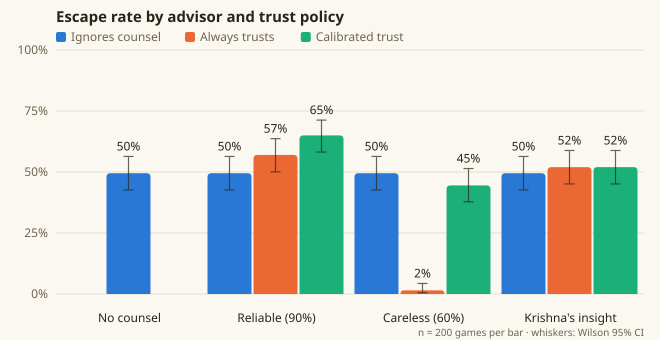

# Counsel experiment: how much should you trust an advisor?

Generated by `node sim/counsel.js`: 200 seeds per cell, medium information, both sides coordinated. Every cell plays the same 200 formations. Good counsel = the move an expert with the true map and sight of every sentinel would accept.

| Advisor | Trust policy | Escaped (95% CI) | Counsel right | Followed good | Followed bad |
|---|---|---|---|---|---|
| No counsel | — | 49.5% (42.6–56.4%) | — | — | — |
| Reliable (90%) | Ignores counsel | 49.5% (42.6–56.4%) | 90.3% | 81.9% | 5.3% |
| Reliable (90%) | Always trusts | 57.0% (50.1–63.7%) | 90.9% | 100.0% | 100.0% |
| Reliable (90%) | Calibrated trust | 65.0% (58.2–71.3%) | 90.3% | 92.5% | 22.9% |
| Careless (60%) | Ignores counsel | 49.5% (42.6–56.4%) | 62.6% | 80.4% | 4.4% |
| Careless (60%) | Always trusts | 1.5% (0.5–4.3%) | 67.1% | 100.0% | 100.0% |
| Careless (60%) | Calibrated trust | 44.5% (37.8–51.4%) | 63.6% | 91.7% | 27.4% |
| Krishna's insight | Ignores counsel | 49.5% (42.6–56.4%) | 94.6% | 94.7% | 46.7% |
| Krishna's insight | Always trusts | 52.0% (45.1–58.8%) | 95.0% | 100.0% | 100.0% |
| Krishna's insight | Calibrated trust | 52.0% (45.1–58.8%) | 95.1% | 100.0% | 100.0% |

## Tests against playing without counsel

| Comparison | Escape A | Escape B | Difference | p |
|---|---|---|---|---|
| No counsel → reliable, always trust | 49.5% | 57.0% | +7.5 pts | 0.133 |
| No counsel → reliable, calibrated | 49.5% | 65.0% | +15.5 pts | 0.002 |
| No counsel → careless, always trust | 49.5% | 1.5% | -48.0 pts | < 0.001 |
| No counsel → careless, calibrated | 49.5% | 44.5% | -5.0 pts | 0.316 |
| Careless: always trust → calibrated | 1.5% | 44.5% | +43.0 pts | < 0.001 |
| No counsel → Krishna's insight, always trust | 49.5% | 52.0% | +2.5 pts | 0.617 |

## Reading the results

- **Good counsel helps, and calibrated trust helps most.** With a reliable messenger, success rises from 49.5% to 57.0% for a player who always trusts it, and 65.0% for one who checks it against their own map.
- **Blind trust in a bad source is catastrophic.** Always following the careless messenger drops success to 1.5%.
- **Calibration limits the damage.** Checking counsel against your own map keeps success at 44.5% with the careless messenger, not significantly different from playing without counsel (49.5%, p = 0.316).
- **Even good counsel needs judgement.** Always trusting the reliable messenger is not a significant gain (p = 0.133): its occasional wrong steps cost as much as its good ones save. Only calibrated trust turns good counsel into a clear improvement.
- **An advisor that only knows what you know can't fix your blind spots.** Krishna's insight gives good counsel 95.0% of the time, and every wrong piece is wrong because the player's own information was. For a player who already plans perfectly on their own map, trusting it changes little (49.5% → 52.0%, p = 0.617). It can only help a player who reasons less carefully than it does, which is what the human study measures.
- These are scripted policies. The human study measures where real players fall between "always trust" and "ignore", and whether reasons attached to counsel change that.
