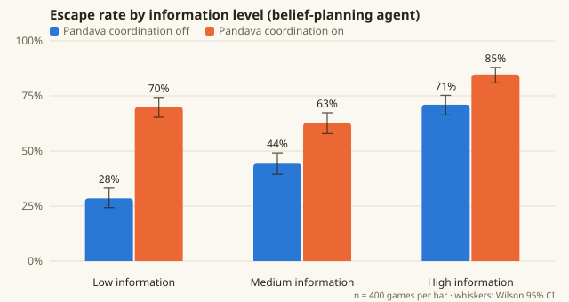
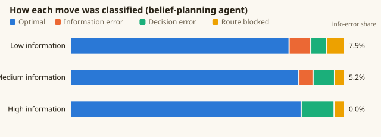

# Simulation results

Generated by `node sim/report.js` from 7,200 simulated games: 3 agents × 12 conditions × 200 seeds. Every condition is played on the **same 200 formations**, so differences come from the condition, not the layout.

Rates are shown with Wilson 95% confidence intervals. Main effects are tested with two-proportion z-tests on the belief-planning agent, pooling over the other two factors.

## Main effects (belief-planning agent)

| Factor | Comparison | Escape rate A | Escape rate B | Difference | z | p |
|---|---|---|---|---|---|---|
| Information | low → high | 49.3% (45.8–52.7%) | 77.9% (74.9–80.6%) | +28.6 pts | 11.90 | < 0.001 |
| Information | low → medium | 49.3% (45.8–52.7%) | 53.5% (50.0–56.9%) | +4.3 pts | 1.70 | 0.089 |
| Information | medium → high | 53.5% (50.0–56.9%) | 77.9% (74.9–80.6%) | +24.4 pts | 10.27 | < 0.001 |
| Pandava coordination | off → on | 47.9% (45.1–50.7%) | 72.5% (69.9–75.0%) | +24.6 pts | 12.30 | < 0.001 |
| Kaurava coordination | off → on | 68.8% (66.1–71.3%) | 51.7% (48.8–54.5%) | -17.1 pts | -8.55 | < 0.001 |

## Every condition (belief-planning agent)

| Information | Pandava coord. | Kaurava coord. | Escaped (95% CI) | Reached core | Mean turns | Optimal moves | Info errors | Decision errors |
|---|---|---|---|---|---|---|---|---|
| low | off | off | 35.5% (29.2–42.3%) | 90.5% | 47.5 | 76.3% | 10.1% | 4.5% |
| low | off | on | 21.5% (16.4–27.7%) | 79.5% | 50.5 | 76.9% | 9.6% | 4.6% |
| low | on | off | 79.5% (73.4–84.5%) | 98.5% | 50.0 | 82.4% | 5.8% | 7.3% |
| low | on | on | 60.5% (53.6–67.0%) | 96.5% | 54.9 | 83.0% | 6.4% | 6.1% |
| medium | off | off | 55.0% (48.1–61.7%) | 93.5% | 45.8 | 82.0% | 5.7% | 8.2% |
| medium | off | on | 33.5% (27.3–40.3%) | 85.0% | 48.8 | 81.3% | 6.2% | 8.1% |
| medium | on | off | 76.0% (69.6–81.4%) | 99.0% | 46.0 | 84.1% | 4.6% | 8.0% |
| medium | on | on | 49.5% (42.6–56.4%) | 96.0% | 51.0 | 85.5% | 4.3% | 7.1% |
| high | off | off | 75.5% (69.1–80.9%) | 96.5% | 47.2 | 83.1% | 0.0% | 12.9% |
| high | off | on | 66.5% (59.7–72.7%) | 89.0% | 48.5 | 83.1% | 0.0% | 11.9% |
| high | on | off | 91.0% (86.2–94.2%) | 100.0% | 46.5 | 84.1% | 0.0% | 12.5% |
| high | on | on | 78.5% (72.3–83.6%) | 99.0% | 48.0 | 86.1% | 0.0% | 10.7% |

## Baselines

| Agent | What it knows | Escaped (95% CI) | Reached core |
|---|---|---|---|
| belief | The player's own belief, exactly what a human sees | 60.2% (58.2–62.1%) | 93.6% |
| oracle | The true formation (upper reference) | 81.8% (80.2–83.2%) | 97.6% |
| random | Nothing; moves at random (lower reference) | 0.0% (0.0–0.2%) | 0.1% |

## Reading the results

- **Live information matters most.** Escape rises from 49.3% with low information to 77.9% with high information.
- **A one-time briefing does not help.** Medium information (53.5%) is statistically no better than low (49.3%, p = 0.089). Once the formation turns, an old map stops paying off: the agent keeps trusting walls that have moved since it was briefed.
- **Coordination is a force multiplier.** Linking the allies moves escape from 47.9% to 72.5%.
- **The opponent's coordination counts as much as your own.** When the Kauravas share sightings and Drona adapts, escape falls from 68.8% to 51.7%.
- **High information produces zero information errors**, which confirms the metric does what it claims: every remaining mistake is a decision error.

These are scripted agents, not people. They give the reference curve that human play-testing (the user study) will be compared against.
